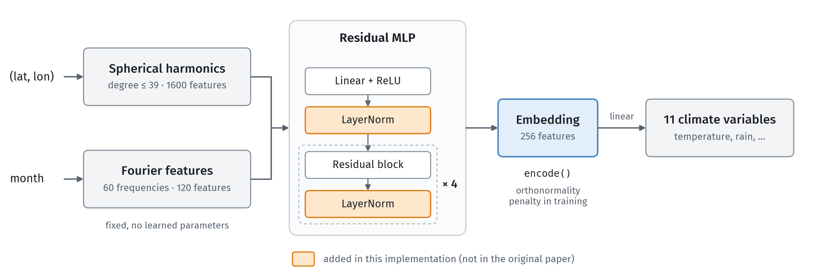

# STE: Space-Time Encoder trained on CHELSA

A PyTorch reimplementation of the joint space-time location encoder from
[A Joint Space-Time Encoder for Geographic Time-Series Data](#citation) (Mickisch et al., 2025), trained to
predict 11 monthly climate variables from CHELSA v2.1 (1981–2010 climatology) given `(lat, lon, month)`.
This repo reimplements its best configuration, Fourier time
encoding with the orthonormality regularizer, **with one architectural change: LayerNorm** ([below](#differences-from-the-paper)).
It is the reimplementation used as a baseline in
[Chronosphere: Space-Time Tessellation of Local Climate Experts](#citation) (Cher et al., 2026).
The trained weights (0.97M parameters, 3.9 MB) ship with the package.

## Architecture



The orange LayerNorms are added in this implementation; the paper's network has none. Each residual block
computes x + ReLU(Linear(Dropout(ReLU(Linear(x))))), with width 256. The training loss is
MSE + 0.01 · ‖AᵀA/B − I‖²_F, where A is the batch of embeddings (B × 256).

## Install

```bash
pip install git+https://github.com/mvrl/Space-Time-Encoder
```

Requires Python ≥ 3.10 and PyTorch ≥ 2.1.

## Usage

```python
import torch
import ste

model = ste.from_pretrained()

latlon = torch.tensor([[38.63, -90.20], [-3.47, -62.37]])    # (lat, lon) in degrees
month = torch.tensor([7, 1])                                  # 1..12

emb = model.encode(latlon, month)    # (2, 256) embedding
y = model(latlon, month)             # (2, 11) normalized CHELSA variables
phys = ste.denormalize(y)            # physical units, columns ste.VAR_NAMES, units ste.UNITS
```

- `encode` returns the last hidden layer (the one the orthonormality penalty acts on). Use it as the
  location–time embedding for downstream probes.
- The month encoding is cyclic: `month=0` equals `month=12`. Training only saw integer months 1–12.
- Training covered land pixels from 55.5°S to 81.5°N. Oceans and Antarctica are extrapolation.
- `ste.from_pretrained(path=...)` loads a checkpoint you trained yourself (`.pt` or `.safetensors`).

## Accuracy

Mean R² over the 11 variables is **0.970**. R² is computed for each variable on 20,000 random pixels from
the held-out 2% of land pixels, one month per pixel, so it covers both spatial and seasonal variation.

| variable | description | R² | RMSE |
|---|---|---:|---|
| `cmi` | climate moisture index | 0.976 | 16.4 kg m⁻² month⁻¹ |
| `clt` | total cloud cover | 0.984 | 2.26 % |
| `hurs` | near-surface relative humidity | 0.976 | 1.83 % |
| `pet` | potential evapotranspiration (Penman) | 0.990 | 6.53 kg m⁻² month⁻¹ |
| `pr` | precipitation | 0.974 | 14.5 kg m⁻² month⁻¹ |
| `rsds` | surface downwelling shortwave radiation | 0.993 | 0.662 MJ m⁻² d⁻¹ |
| `sfcWind` | near-surface wind speed | 0.799 | 0.740 m s⁻¹ |
| `tas` | mean air temperature | 0.995 | 1.28 °C |
| `tasmax` | maximum air temperature | 0.994 | 1.39 °C |
| `tasmin` | minimum air temperature | 0.994 | 1.34 °C |
| `vpd` | vapor pressure deficit | 0.992 | 65.7 Pa |

## Differences from the paper

**LayerNorm (architecture change).** The paper uses the FCNet from GeoPrior, a residual MLP with no
normalization, so its hidden activations are unbounded. We add a LayerNorm after the input layer
(Linear → ReLU → LayerNorm) and after every residual block (`LayerNorm(x + block(x))`). Without it, the
embedding diverges under spatial extrapolation.

Other choices where the paper differs or leaves details open:

- **Size.** Width 256 with 4 residual blocks (0.97M parameters), matching Chronosphere's network, instead of
  the paper's width 1024 (10.2M parameters).
- **Data and targets.** Trained on CHELSA v2.1 monthly climatology with 11 output variables, instead of the
  paper's simulated ACE data and 8 temperature targets.
- **Time input.** The Fourier encoding takes τ = 2π·month/12, so December and January are neighbors.
  The paper maps time linearly to [−1, 1].
- **Training protocol.** CLIMPLICIT's: AdamW (lr 1e-4, weight decay 0.01), ReduceLROnPlateau
  (factor 0.5, patience 5) on validation MSE, gradient clipping at 1.0, early stopping after 15
  validation checks without improvement, batch 8192, at most 100 epochs.

## Training

```bash
pip install -e ".[data]"
bash scripts/download_chelsa.sh /path/to/chelsa_raw                    # 11 variables x 12 months of GeoTIFFs
python scripts/chelsa_to_numpy.py --raw-dir /path/to/chelsa_raw --out-dir /path/to/chelsa_numpy
python train.py --numpy-dir /path/to/chelsa_numpy --in-memory
```

`chelsa_to_numpy.py` keeps the ~224M land pixels and normalizes each variable with CLIMPLICIT's constants
(`ste/chelsa.py`). Each month is ~5 GB, and `--in-memory` loads all 12 into RAM (~60 GB). Without it, the
arrays are memory-mapped, which is much slower.

## Citation

If you use this code or the weights, please cite the original paper and Chronosphere:

```bibtex
@inproceedings{mickisch2025ste,
  title     = {A Joint Space-Time Encoder for Geographic Time-Series Data},
  author    = {Mickisch, David and Klemmer, Konstantin and Teng, M{\'e}lisande and Rolnick, David},
  booktitle = {ICLR 2025 Workshop on Machine Learning Multiscale Processes},
  year      = {2025}
}

@misc{cher2026chronosphere,
  title  = {Chronosphere: Space-Time Tessellation of Local Climate Experts},
  author = {Cher, Daniel and Xing, Eric P. and Li, Kexing and Wei, Brian and Corley, Isaac and Jacobs, Nathan},
  year   = {2026}
}
```

and, for the training data, normalization, and spherical harmonics:

```bibtex
@article{karger2017chelsa,
  title   = {Climatologies at high resolution for the earth's land surface areas},
  author  = {Karger, Dirk Nikolaus and Conrad, Olaf and B{\"o}hner, J{\"u}rgen and Kawohl, Tobias and Kreft, Holger and Soria-Auza, Rodrigo Wilber and Zimmermann, Niklaus E. and Linder, H. Peter and Kessler, Michael},
  journal = {Scientific Data},
  volume  = {4},
  pages   = {170122},
  year    = {2017},
  doi     = {10.1038/sdata.2017.122}
}

@inproceedings{dollinger2025climplicit,
  title     = {Climplicit: Climatic Implicit Embeddings for Global Ecological Tasks},
  author    = {Dollinger, Johannes and Robert, Damien and Plekhanova, Elena and Drees, Lukas and Wegner, Jan Dirk},
  booktitle = {ICLR 2025 Workshop: Tackling Climate Change with Machine Learning},
  year      = {2025}
}

@inproceedings{russwurm2024siren,
  title     = {Geographic Location Encoding with Spherical Harmonics and Sinusoidal Representation Networks},
  author    = {Ru{\ss}wurm, Marc and Klemmer, Konstantin and Rolf, Esther and Zbinden, Robin and Tuia, Devis},
  booktitle = {International Conference on Learning Representations (ICLR)},
  year      = {2024}
}
```

## License

MIT. The spherical-harmonics code (`ste/spherical_harmonics*.py`) is derived from
[SatCLIP](https://github.com/microsoft/satclip) (MIT, Copyright (c) Microsoft Corporation); see `LICENSE`.
